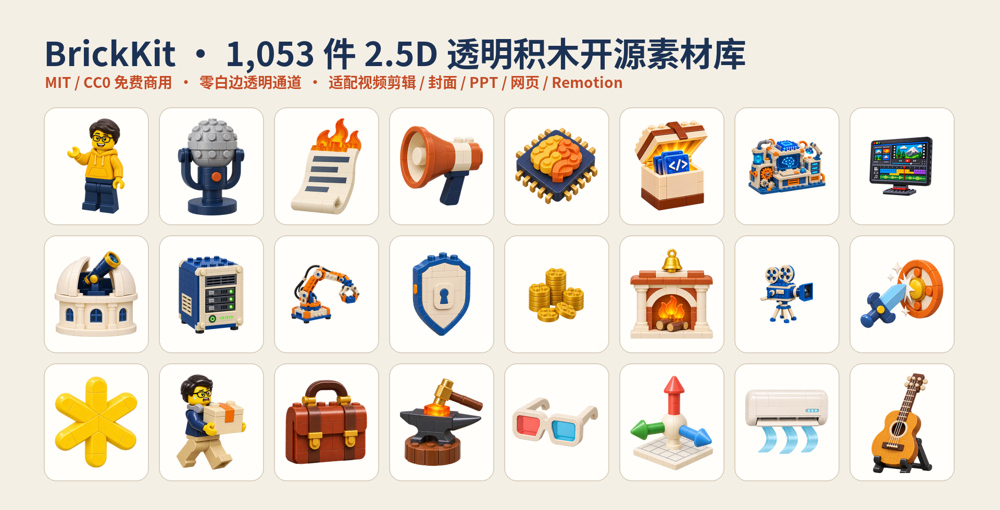

<p align="right"><strong>中文</strong> · <a href="README_EN.md">English</a></p>

<div align="center">
  
  <h1>BrickKit · 开源 2.5D 透明积木素材库</h1>
  <p><strong>1,077 件统一丝光 ABS 质感的 2.5D 透明积木道具，CC0 / MIT 无门槛免费商用。</strong></p>
  <p>零白边透明通道 · 1440p 高清母版 · 剪视频、做封面、写 PPT、搭网页与 Remotion 动效即拿即用</p>
  <p>
    <a href="https://kun97.tech/video-studio/"><strong>🔍 在线搜索 &amp; 一键直下透明 PNG（kun97.tech）</strong></a>
    &nbsp;·&nbsp;
    <a href="https://github.com/KunZhang1997/BrickKit/releases/latest"><strong>⬇️ 下载全量 PNG 压缩包（Releases）</strong></a>
    &nbsp;·&nbsp;
    <a href="https://kun97.tech"><strong>🏠 作者 Kun 的 3D 积木主页</strong></a>
    &nbsp;·&nbsp;
    <a href="README_EN.md">English</a>
  </p>
</div>



> **为什么开源 BrickKit？**  
> 做科技口播视频、封面和产品演示时，最头疼的是网上找来的贴图画风各异：扁平矢量、写实照片、霓虹渐变堆在一块显得很杂乱。于是我按统一的**明亮暖白影棚柔光 + 温润丝光 ABS 积木分件质感 + 干净无白边 Alpha 透明通道**，系统性打磨了 **1,077 件** 高频立体道具，并决定以 **CC0-1.0 / MIT** 完全开源出来分享给所有创作者与开发者。

---

## 仓库收录规模（共 1,077 件 · 12 大分类）

所有素材均已完成前景色边缘去白边（Halo-Free Alpha Decontamination）与高清化处理，放在米白底、深色底或实拍视频上均干净通透、不带脏灰边。

| 分类名称 | 目录路径 | 数量 | 典型收录道具举例 |
| --- | --- | ---: | --- |
| **生活与空间** | [`assets/life-spaces/`](assets/life-spaces/) | **139** | 独立书房、咖啡机、沙漏、台灯、日历、温暖壁炉、行李箱 |
| **自然与寓言** | [`assets/nature-fables/`](assets/nature-fables/) | **117** | 星空天文台、松石盆景、灯塔、帆船、岛屿、麦田、飞鸟 |
| **AI 与算力** | [`assets/ai-compute/`](assets/ai-compute/) | **135** | ChatGPT / Claude / Gemini / DeepSeek / Grok / 豆包 / Kimi 等 24 款 AI 立体徽标、算力机柜 |
| **数码与开发** | [`assets/tech-dev/`](assets/tech-dev/) | **106** | 开源代码盒、机械臂、笔记本电脑、终端报错、安全盾牌、硬盘 |
| **商业与职场** | [`assets/business-work/`](assets/business-work/) | **94** | 燃烧长账单、金币堆、公文包、市场摊位、天平、合同印章 |
| **自媒体与传播** | [`assets/creator-media/`](assets/creator-media/) | **88** | 桌面播客麦克风、暖橙扩音大喇叭、视频剪辑台、摄影机、提词器 |
| **影视游戏与治理** | [`assets/culture-gaming/`](assets/culture-gaming/) | **72** | 红蓝 3D 眼镜、手柄、场记板、奖杯、舞台聚光灯、规则路牌 |
| **逻辑与积木件** | [`assets/logic-symbols/`](assets/logic-symbols/) | **72** | 立体对勾、叉号、问号、感叹号、分流箭头、多维坐标轴 |
| **商业电商与制造** | [`assets/commerce-industry/`](assets/commerce-industry/) | **68** | 铁砧锻造台、物流包裹、传送带、购物车、精密齿轮组 |
| **UI 与交互控件** | [`assets/ui-controls/`](assets/ui-controls/) | **64** | 立体搜索框、森绿拨动开关、进度条、通知铃铛、配色色卡扇 |
| **科学医疗与教育** | [`assets/science-edu/`](assets/science-edu/) | **64** | 显微镜、烧杯、DNA 双螺旋、原木吉他、地球仪、量角器 |
| **人物与动作** | [`assets/characters-poses/`](assets/characters-poses/) | **58** | 创作者讲解/思考/竖赞/实操姿态、积木大手按启动键、双人协作组 |
| **合计** | [`catalog.json`](catalog.json) | **1,077** | 全部附带中文标题、分类、尺寸与场景标签索引 |

---

## 三种极速使用方式

### 方式 1：在线搜索 + 单张一键直下透明 PNG（推荐日常挑图）

打开 **[https://kun97.tech/video-studio/](https://kun97.tech/video-studio/)**：
- 支持按中文关键词（如 `麦克风`、`账单`、`服务器`、`天文台`）即时检索；
- 支持一键切换 **暖米白 / 透明棋盘格 / 深海蓝** 三种预览底板检查边缘；
- 点击任一卡片右下角 **`↓ PNG`** 即可直接保存 32-bit 透明底 `.png` 原图，拖进 Final Cut Pro、剪映、Premiere、Keynote、PPT、Figma 即可使用。

### 方式 2：从 GitHub Releases 下载全量 PNG 压缩包

如果你希望一次性把全部 **1,077 张 `.png` 原图** 存进本地素材盘或 NAS：
- 前往 **[GitHub Releases](https://github.com/KunZhang1997/BrickKit/releases/latest)** 下载打包好的全量透明 PNG 压缩包，解压即用。

### 方式 3：克隆本仓库（适合网页 / Remotion / 自动化工程）

为保证 `git clone` 轻量高速，仓库内 `assets/` 直接存放 `1440px` 无损透明通道 RGBA `.webp`（体积仅为原始 PNG 的十分之一，画质与透明边缘一致），并提供完整的 [`catalog.json`](catalog.json) 结构化索引与一键批量转 PNG 脚本：

```bash
git clone https://github.com/KunZhang1997/BrickKit.git
cd BrickKit

# 可选：一键将全部（或指定分类）导出为 32-bit 透明 .png
pip install Pillow
python3 scripts/export_png.py
```

---

## 开源协议（CC0 + MIT 完全免费商用）

- **全部视觉积木图片（`assets/**`）**：采用 **[CC0 1.0 Universal](LICENSE)** 献入公有领域——个人视频、商业广告、UP 主封面、公司汇报 PPT、独立应用与开源项目均可**免费使用、修改和分发**，无需申请授权（如愿附上 `BrickKit by Kun (https://kun97.tech)` 署名将非常感谢）。
- **索引数据与工具脚本（`catalog.json`、`scripts/**`）**：采用 **[MIT License](LICENSE)** 开源。

---

## 关于作者 Kun

你好，我是 **Kun**，一名持续做独立软件与科技实测视频的创作者。欢迎顺路去我的 3D 积木个人主页和其他开源项目逛逛：

- 🌲 **[kun97.tech](https://kun97.tech)** — 我的可交互 3D 积木森林个人主页与创作空间
- 🎙️ **[SpeakSend](https://github.com/KunZhang1997/SpeakSend)** — macOS 语音直输、混合笔记与个人想法网络工具
- 🛠️ **[MacDefier](https://github.com/KunZhang1997/MacDefier)** — 开源 macOS 14+ 卡顿回看诊断、安全空间清理与 AI 模型缓存治理工具
- 📸 **[Captures](https://github.com/KunZhang1997/Captures)** — 开源 macOS 14+ 快速框选截图、滚动长图拼接与本地 OCR 识字工具

如果这套积木素材帮你的视频、PPT 或产品增色了一点点，欢迎点一颗 **Star ★** 支持！
