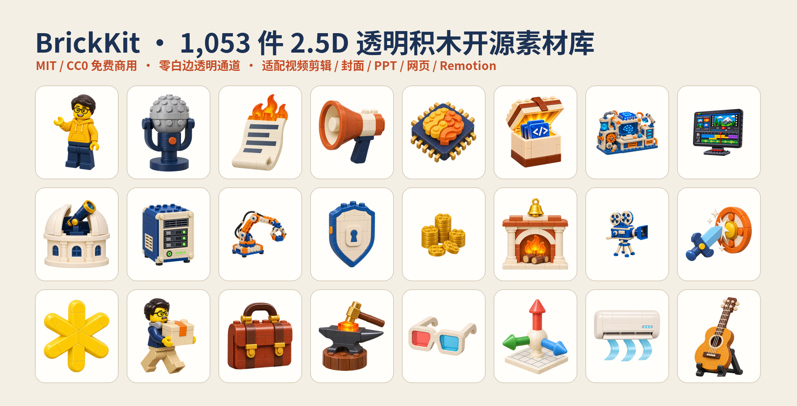

<p align="right"><a href="README.md">中文</a> · <strong>English</strong></p>

<div align="center">
  
  <h1>BrickKit · Open-Source 2.5D Brick Asset Pack</h1>
  <p><strong>1,077 cohesive 2.5D satin-ABS brick illustrations with clean transparent alpha — free for commercial &amp; personal use (CC0 / MIT).</strong></p>
  <p>Halo-free alpha edges · 1440p crisp masters · Built for video creators, thumbnails, slides, web UI &amp; Remotion</p>
  <p>
    <a href="https://kun97.tech/video-studio/"><strong>🔍 Live Search &amp; 1-Click PNG Download (kun97.tech)</strong></a>
    &nbsp;·&nbsp;
    <a href="https://github.com/KunZhang1997/BrickKit/releases/latest"><strong>⬇️ Full PNG Pack (GitHub Releases)</strong></a>
    &nbsp;·&nbsp;
    <a href="https://kun97.tech"><strong>🏠 Kun's 3D Brick Homepage</strong></a>
    &nbsp;·&nbsp;
    <a href="README.md">中文说明</a>
  </p>
</div>



## What's Inside (1,077 Assets · 12 Categories)

Every asset in **BrickKit** shares a unified studio softbox lighting setup, tactile satin ABS brick seams, and decontaminated transparent edges that composite cleanly onto light cream cards, dark backgrounds, or video timelines.

| Category | Folder | Count |
| --- | --- | ---: |
| **Life & Spaces** | [`assets/life-spaces/`](assets/life-spaces/) | **139** |
| **Nature & Fables** | [`assets/nature-fables/`](assets/nature-fables/) | **117** |
| **AI & Compute** | [`assets/ai-compute/`](assets/ai-compute/) | **135** |
| **Tech & Dev** | [`assets/tech-dev/`](assets/tech-dev/) | **106** |
| **Business & Work** | [`assets/business-work/`](assets/business-work/) | **94** |
| **Creator & Media** | [`assets/creator-media/`](assets/creator-media/) | **88** |
| **Culture & Gaming** | [`assets/culture-gaming/`](assets/culture-gaming/) | **72** |
| **Logic & Symbols** | [`assets/logic-symbols/`](assets/logic-symbols/) | **72** |
| **Commerce & Industry** | [`assets/commerce-industry/`](assets/commerce-industry/) | **68** |
| **UI & Controls** | [`assets/ui-controls/`](assets/ui-controls/) | **64** |
| **Science & Education** | [`assets/science-edu/`](assets/science-edu/) | **64** |
| **Characters & Poses** | [`assets/characters-poses/`](assets/characters-poses/) | **58** |
| **Total** | [`catalog.json`](catalog.json) | **1,077** |

## Quick Start

1. **Online Picker & 1-Click PNG Download**: Visit **[https://kun97.tech/video-studio/](https://kun97.tech/video-studio/)** to filter, preview on Cream / Checker / Navy backdrops, and download 32-bit transparent `.png` files individually.
2. **Full PNG ZIP Archive**: Grab the pre-exported PNG archive from **[GitHub Releases](https://github.com/KunZhang1997/BrickKit/releases/latest)**.
3. **Clone & Batch Export**:
   ```bash
   git clone https://github.com/KunZhang1997/BrickKit.git
   cd BrickKit
   pip install Pillow
   python3 scripts/export_png.py
   ```

## License

- **Visual Assets (`assets/**`)**: **[CC0 1.0 Universal](LICENSE)** — free for personal and commercial use without restriction.
- **Metadata & Tooling (`catalog.json`, `scripts/**`)**: **[MIT License](LICENSE)**.

## Created by Kun (@KunZhang1997)

- 🌲 **[kun97.tech](https://kun97.tech)** — Interactive 3D brick homepage & studio
- 🎙️ **[SpeakSend](https://github.com/KunZhang1997/SpeakSend)** — Voice dictation, hybrid notes & idea network for macOS
- 🛠️ **[MacDefier](https://github.com/KunZhang1997/MacDefier)** — Open-source macOS diagnostics, safe cleanup & AI model cache manager
- 📸 **[Captures](https://github.com/KunZhang1997/Captures)** — Open-source macOS screenshot, scrolling capture & local OCR utility
